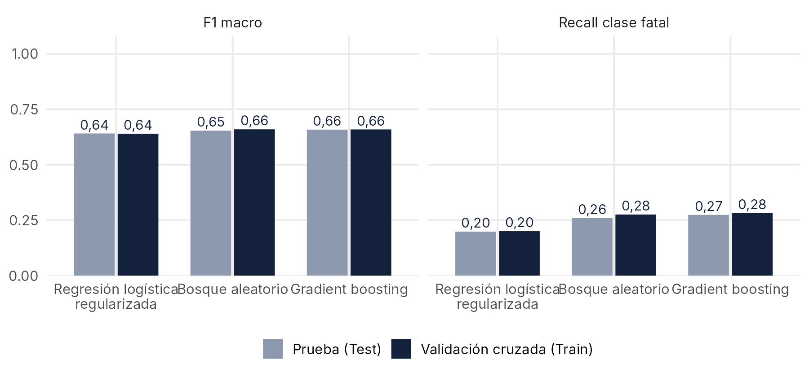
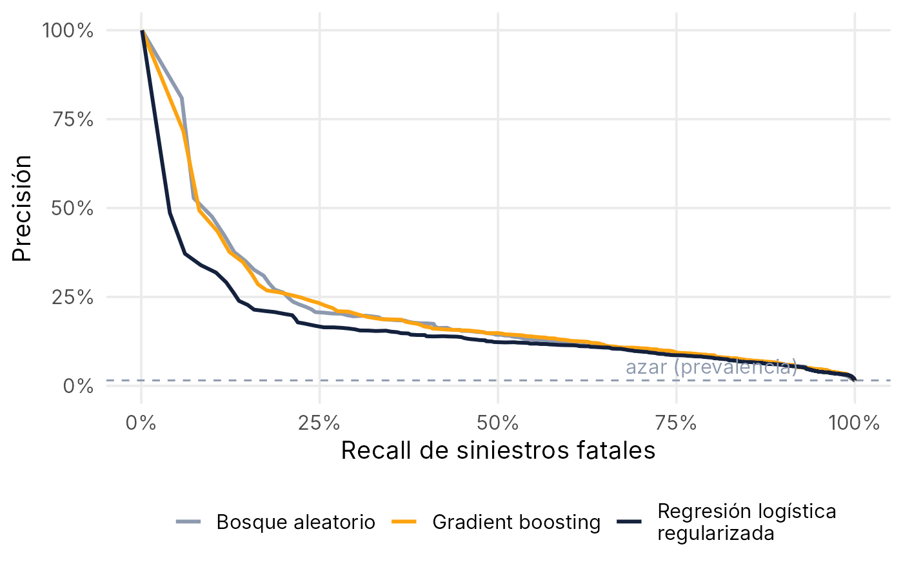
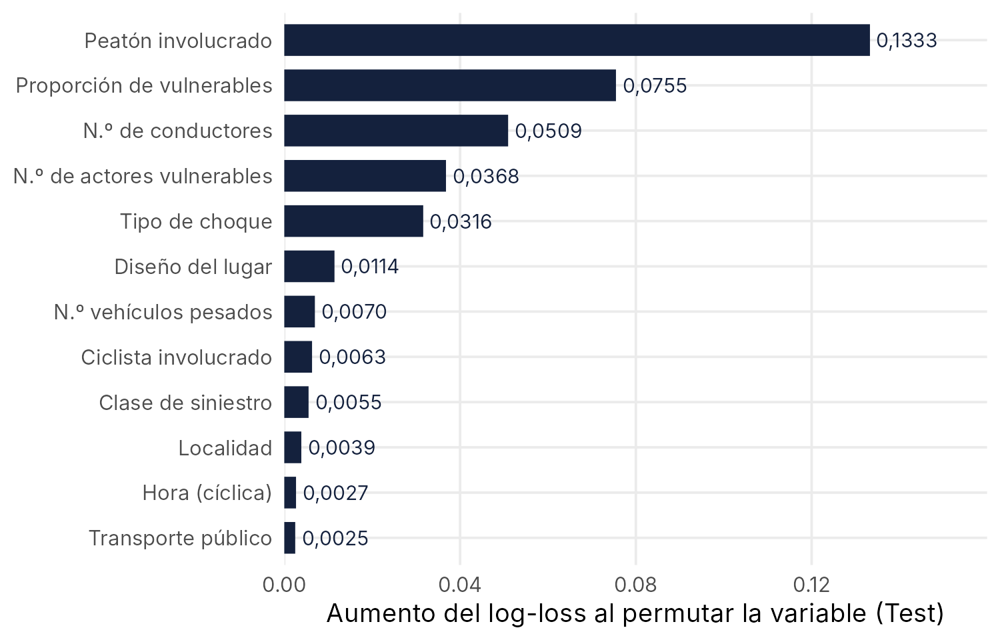

```{r setup, include=FALSE}
knitr::opts_chunk$set(echo = FALSE, warning = FALSE, message = FALSE, fig.align = "center",
                      out.width = "92%", fig.height = 3.3, dpi = 130, fig.pos = "H")
options(OutDec = ",", knitr.kable.NA = "—", scipen = 999)
suppressPackageStartupMessages({
  library(dplyr); library(tidyr); library(ggplot2); library(readr); library(stringr)
  library(knitr); library(kableExtra); library(scales)
})
source("scripts/funciones.R")           # rutas relativas a la raíz del proyecto

# Si el flujo aún no se ha ejecutado, el informe lo ejecuta de principio a fin
if (!file.exists("datos/raw/SINIESTROS.csv"))               source("scripts/00_descarga_datos.R")
if (!file.exists("datos/clean/siniestros_integrado.rds"))   source("scripts/01_integracion_limpieza.R")
if (!file.exists("modelos/parametros_transformacion.rds"))  source("scripts/02_particion_transformacion.R")

if (!file.exists("resultados/modelado.rds"))               source("scripts/04_modelado.R")
if (!file.exists("resultados/clusters.rds"))                source("scripts/06_agrupamiento.R")
if (!file.exists("resultados/evaluacion.rds"))              source("scripts/05_evaluacion_interpretacion.R")

# Datos crudos (solo para auditoría descriptiva), integrados, Train/Test y parámetros
rd  <- function(f) read_csv(file.path("datos/raw", f), col_types = cols(.default = col_character()), na = c("", "NA"), progress = FALSE)
sin <- rd("SINIESTROS.csv"); act <- rd("ACTOR_VIAL.csv"); veh <- rd("VEHICULOS.csv"); hip <- rd("HIPOTESIS.csv")
aud <- readRDS("resultados/auditoria_limpieza.rds")
int <- readRDS("datos/clean/siniestros_integrado.rds")
P   <- readRDS("modelos/parametros_transformacion.rds")
trL <- readRDS("datos/clean/train_legible.rds"); teL <- readRDS("datos/clean/test_legible.rds")
trM <- readRDS("datos/clean/train_ml.rds");      teM <- readRDS("datos/clean/test_ml.rds")
trP <- readRDS("datos/clean/train_pca.rds")
mo <- readRDS("resultados/modelado.rds"); ev <- readRDS("resultados/evaluacion.rds"); cl <- readRDS("resultados/clusters.rds")
nm <- c(glmnet = "Regresión logística regularizada", ranger = "Bosque aleatorio", xgboost = "Gradient boosting (XGBoost)")
tr_pre <- int %>% filter(codigo_accidente %in% P$ids_train)      # Train ANTES de imputar/winsorizar/escalar
te_pre <- int %>% filter(!codigo_accidente %in% P$ids_train)

fmt <- function(x, d = 0) formatC(x, format = "f", digits = d, big.mark = ".", decimal.mark = ",")
pct <- function(x, d = 1) paste0(formatC(100 * x, format = "f", digits = d, decimal.mark = ","), " %")
tab <- function(d, cap, ...) kable(d %>% mutate(across(where(is.character), ~ str_remove_all(.x, "\\*\\*|`"))), format = "latex", booktabs = TRUE, caption = cap, linesep = "", ...,
                                   format.args = list(big.mark = ".", decimal.mark = ",")) %>%
  kable_styling(latex_options = c("hold_position", "scale_down"), font_size = 8.5)
col_grav <- c("Solo danos" = "#4C78A8", "Con heridos" = "#F58518", "Con muertos" = "#B22222")
tema <- theme_minimal(base_size = 9) + theme(plot.title = element_text(face = "bold", size = 9.5), legend.position = "bottom")
```

\newpage

# Introducción y justificación

## Contexto del fenómeno

Cada siniestro vial ocurrido en Bogotá D.C. es registrado por la autoridad de tránsito en el lugar de los hechos mediante el Informe Policial de Accidentes de Tránsito (IPAT) y consolidado por la Secretaría Distrital de Movilidad en el Sistema de Información Geográfico de Accidentes de Tránsito (SIGAT). El registro captura la fecha y hora del evento, su ubicación, la clase de siniestro, los vehículos involucrados y las características de los actores viales afectados.

Mediante el Decreto 494 de 2023 la ciudad adoptó el Plan Distrital de Seguridad Vial 2023–2032, cuya meta es reducir en 50 % el número de víctimas fatales tomando como línea base el año 2022. Las medidas disponibles para alcanzar esa meta (control de velocidad, rediseño de intersecciones, señalización, campañas dirigidas a actores viales específicos y distribución del patrullaje) son costosas y limitadas, mientras que los siniestros **no se distribuyen de manera homogénea**: se concentran en ciertos corredores, franjas horarias y tipos de usuario de la vía.

El conjunto de datos público utilizado en este proyecto reúne `r fmt(nrow(sin))` siniestros registrados entre `r format(min(int$fecha), "%d/%m/%Y")` y `r format(max(int$fecha), "%d/%m/%Y")`, con `r fmt(nrow(act))` registros de actores viales y `r fmt(nrow(veh))` registros de vehículos. De ellos, solo `r pct(mean(int$gravedad == "Con muertos"), 1)` terminó en víctimas fatales: el evento de mayor interés para la política pública es, a la vez, el más raro.

## Justificación: por qué minería de datos

Hoy el análisis institucional es mayoritariamente **descriptivo y agregado** (conteos por localidad, año o clase de siniestro). Ese enfoque responde *dónde y cuántos*, pero no permite (i) anticipar el nivel de gravedad esperado de un evento dadas sus condiciones, ni (ii) identificar **combinaciones** de condiciones (tipo de actor, clase de vehículo, momento del día, localidad) cuyo efecto conjunto es distinto de la suma de sus partes. La minería de datos aporta modelos de clasificación que cuantifican esa relación y técnicas de agrupamiento que segmentan la siniestralidad en perfiles de riesgo con recomendaciones diferenciadas. El valor estratégico para la toma de decisiones es la **focalización**: orientar obras de infraestructura, operativos de control y campañas hacia donde el impacto sobre la reducción de víctimas fatales sea mayor.

## Objetivos

**Objetivo general.** Construir y evaluar un modelo de minería de datos que permita clasificar la gravedad de un siniestro vial en Bogotá (solo daños materiales, con heridos, con víctimas fatales) a partir de las condiciones del evento, e identificar perfiles de riesgo que apoyen la focalización de intervenciones de seguridad vial.

```{r objetivos}
tibble(
  `Objetivo específico` = c(
    "1. Integrar Siniestros, Vehículos y Actor Vial en una tabla analítica a nivel de siniestro con el diccionario oficial.",
    "2. Caracterizar la siniestralidad por localidad, franja horaria, día y tipo de actor, cuantificando el desbalance de la variable objetivo.",
    "3. Construir variables derivadas de la dimensión temporal y del perfil de los involucrados.",
    "4. Entrenar y comparar al menos tres técnicas de clasificación con métricas para clases desbalanceadas.",
    "5. Aplicar agrupamiento para identificar perfiles de alto riesgo e interpretarlos como recomendaciones de política."),
  `Fase del proceso` = c("KDD 2–3 (selección, limpieza)", "KDD 1–2 (dominio, exploración sobre Train)",
                         "KDD 4 (transformación)", "KDD 5 (minería de datos)", "KDD 5, interpretación y evaluación"),
  `Alcance` = rep("Cumplido", 5)) %>%
  tab("Objetivos específicos mapeados a las fases del proceso; todos se cumplieron (secciones 3 a 8).") %>%
  column_spec(1, width = "8.3cm") %>% column_spec(2, width = "4.2cm")
```

# Fase 1 de KDD — Dominio del problema

## Preguntas de investigación e hipótesis

La entidad necesita entender qué combinación de condiciones está asociada con los desenlaces más graves. Se formulan las siguientes preguntas, cada una con su hipótesis de trabajo:

| Pregunta analítica | Hipótesis |
|:---------------------------|:--------------------------------------------------|
| **P1.** ¿Participar un actor vial vulnerable modifica la gravedad del siniestro? | **H1.** La participación de actores viales vulnerables (peatones y motociclistas) se asocia significativamente con mayor gravedad, por encima del efecto de la clase de siniestro o la localidad. |
| **P2.** ¿Importan el momento del día y el tipo de día? | **H2.** Los siniestros en franjas nocturnas y fines de semana tienen mayor probabilidad de desenlace fatal que los diurnos de días hábiles. |
| **P3.** ¿Existen perfiles de siniestro diferenciables? | **H3.** Existen agrupaciones según la combinación de localidad, franja horaria y tipo de actor, que segmentan la siniestralidad en perfiles de riesgo con intervenciones distintas. |

## Variables críticas esperadas y beneficio tangible

* **Variable objetivo:** gravedad del siniestro, con tres clases ordenadas: *Solo daños*, *Con heridos* y *Con muertos*.
* **Predictores esperados:** tipo de actor vial (peatón, ciclista, motociclista), clase de vehículo y su heterogeneidad, franja horaria, día de la semana y tipo de día (hábil, fin de semana, festivo), localidad, clase de siniestro y diseño del lugar.
* **Usuarios y beneficio:** la Secretaría Distrital de Movilidad y la autoridad de tránsito pueden priorizar intervenciones de infraestructura, programar operativos de control y diseñar campañas dirigidas a grupos específicos, con una herramienta que estime el nivel de gravedad esperado y señale perfiles de riesgo combinados.

## Restricción conceptual: qué se puede usar como predictor

Un modelo útil para la toma de decisiones solo puede emplear información disponible **sobre las condiciones del evento**, no sobre sus consecuencias. Por eso el estado de los actores (ileso, herido, muerto), que *define* la gravedad, jamás entra como predictor; se usa únicamente para auditar la consistencia de la variable objetivo (Sección 4.3). Este criterio se desarrolla con un caso concreto en la Sección 3.4.

# Fase 2 de KDD — Selección de datos

## Fuente de origen

Los datos provienen del conjunto abierto **"Siniestros Viales Consolidados Bogotá D.C."** de la Secretaría Distrital de Movilidad, publicado en el portal de Datos Abiertos de Bogotá (`datosabiertos.bogota.gov.co`). Es un libro de Excel (aprox. 49 MB) con cinco hojas, que se descarga y exporta a CSV con `scripts/00_descarga_datos.R` hacia `datos/raw/`. El diccionario de datos oficial viene en la propia hoja `DICCIONARIO`.

```{r fuente}
tibble(Hoja = c("SINIESTROS", "ACTOR_VIAL", "VEHICULOS", "HIPOTESIS", "DICCIONARIO"),
       Filas = c(nrow(sin), nrow(act), nrow(veh), nrow(hip), 211),
       Granularidad = c("Un registro por siniestro (llave `CODIGO_ACCIDENTE`)", "Un registro por persona involucrada",
                        "Un registro por vehículo involucrado", "Una o más causas probables por siniestro", "Códigos y descripciones"),
       `Uso en el proyecto` = c("Núcleo analítico y variable objetivo", "Perfil de involucrados", "Perfil de vehículos",
                                "Descartada (ver 3.3)", "Decodificación de categorías")) %>%
  mutate(Granularidad = str_replace_all(Granularidad, "`", "")) %>%
  tab("Estructura del consolidado oficial de siniestros viales.") %>% column_spec(3, width = "5.5cm")
```

La integración requiere pasar de tres granularidades (siniestro, persona, vehículo) a una sola **tabla analítica a nivel de siniestro**. El resultado final es una fila por siniestro con `r ncol(int)` columnas.

## Diccionario de variables y decisión de selección

El diccionario completo (tipo, descripción y decisión sobre cada variable) está en el **Anexo A**; las decisiones de descarte se justifican a continuación.


## Justificación de variables descartadas y excluidas

1. **`HIPOTESIS` (causa probable).** Se asigna *después* de la investigación del siniestro; no está disponible al momento de pronosticar la gravedad y su uso introduciría información posterior al hecho. Se descarta.
2. **`OBJETO_FIJO`.** Presenta `r pct(aud$nulos_siniestros[["OBJETO_FIJO"]], 1)` de vacíos que son **estructurales** (solo se diligencia cuando `CHOQUE = Objeto fijo`), está subsumida por `tipo_choque` y generaría decenas de columnas casi vacías. Se descarta por exceso de valores vacíos y redundancia.
3. **`MODALIDAD` del vehículo.** Tiene `r pct(aud$nulos_vehiculos[["MODALIDAD"]], 1)` de vacíos, también estructurales: solo se diligencia en transporte público (`r fmt(sum(is.na(veh$MODALIDAD) & veh$SERVICIO %in% "2"))` vacíos entre los vehículos de servicio público frente a `r fmt(sum(is.na(veh$MODALIDAD) & veh$SERVICIO %in% "3"))` entre los particulares). La información útil ya está en `SERVICIO`. Se descarta.
4. **`DIRECCION`.** Texto libre de cardinalidad altísima. Solo se conserva un indicador derivado, `via_avenida` (la dirección inicia con AV, AK, AC o AU). La georreferenciación fina se deja como trabajo futuro.
5. **`ESTADO` del actor.** Define la gravedad; se usa exclusivamente para verificar la consistencia de la variable objetivo.
6. **Pasajeros/acompañantes.** Se excluyen de *todas* las variables derivadas (Sección 3.4).

## Un hallazgo de fuga de objetivo en los propios datos {#fuga}

```{r pasajeros}
pt <- aud$pasajeros_por_estado
pas <- as.data.frame.matrix(pt)
rownames(pas)[grepl("^PASAJERO", rownames(pas))] <- "PASAJERO"
```

Al auditar la hoja `ACTOR_VIAL` se observó que los registros no son una lista completa de ocupantes: de `r fmt(sum(pas["PASAJERO", ]))` pasajeros registrados, solo `r fmt(pas["PASAJERO", "ILESO"])` están ilesos; de `r fmt(sum(pas["PEATON", ]))` peatones, solo `r fmt(pas["PEATON", "ILESO"])` lo están. En cambio, `r fmt(pas["CONDUCTOR", "ILESO"])` de `r fmt(sum(pas["CONDUCTOR", ]))` conductores están ilesos. Es decir, **los pasajeros solo aparecen en la base cuando resultaron lesionados**. Contar pasajeros (o el total de personas registradas) equivaldría a *leer la respuesta*: un siniestro "con pasajeros registrados" es casi por construcción un siniestro con heridos o muertos.

Decisión: todas las variables derivadas del perfil de involucrados se calculan sobre conductores, motociclistas, ciclistas y peatones, y **no se emplean los pasajeros**. El peatón se conserva porque la hipótesis H1 lo exige y porque físicamente un atropello casi siempre lesiona; sin embargo se documenta que su alta asociación con la gravedad refleja en parte esa relación mecánica y no solo un "efecto de riesgo" independiente, un matiz que deberá considerarse al interpretar los modelos.

# Fase 3 de KDD — Limpieza y preprocesamiento

## Principio rector: cero fuga de datos

Se aplica la regla contra la fuga de datos con una separación estricta en dos tipos de operaciones:

* **Reglas deterministas de dominio** (fila a fila, sin aprender nada de los datos): decodificar categorías con el diccionario, corregir tipos, eliminar duplicados, anular edades imposibles, reconciliar la variable objetivo. Se ejecutan **antes** de la partición (`scripts/01_integracion_limpieza.R`) porque no estiman parámetros.
* **Estadísticas aprendidas** (medianas de imputación, topes de winsorización, medias y desviaciones, niveles de categorías, rotación del PCA): se calculan **solo con Train** en `ajustar_transformacion()` y se aplican de forma idempotente con `aplicar_transformacion()` a Train, Test y al futuro artefacto de despliegue (`scripts/02_particion_transformacion.R`). Los parámetros se guardan en `modelos/parametros_transformacion.rds`.

## Auditoría de integridad y duplicados

La auditoría completa (duplicados exactos, llaves, huérfanos, fechas y horas) está en el **Anexo B**: no se encontraron duplicados exactos, llaves repetidas ni registros huérfanos.


Los `r fmt(aud$siniestros_sin_detalle[["total"]])` siniestros sin actores ni vehículos (`r fmt(aud$sin_detalle_por_gravedad[["2"]])` con heridos y `r fmt(aud$sin_detalle_por_gravedad[["3"]])` solo daños; **ninguno fatal**) no aportan atributos con los cuales construir las variables derivadas. Su eliminación no altera la clase minoritaria. Tras estos pasos, la tabla analítica contiene **`r fmt(aud$filas_finales)` siniestros**.

## Inconsistencias, categorías ambiguas y errores de captura

**Consistencia de la variable objetivo.** Se contrastó la gravedad registrada en `SINIESTROS` con el estado de los actores en `ACTOR_VIAL` (un siniestro "con muertos" debe tener al menos un actor muerto; uno "con heridos", al menos uno herido y ninguno muerto).

```{r consistencia}
ct <- as.data.frame.matrix(aud$consistencia_gravedad)
ct <- cbind(`Gravedad registrada` = c("1 Con muertos", "2 Con heridos", "3 Solo daños"), ct)
names(ct)[2:4] <- c("Actores: muerto", "Actores: herido", "Actores: ilesos")
ct %>% tab("Gravedad registrada frente a la evidencia a nivel de víctima (siniestros con detalle).", row.names = FALSE)
```

Se hallaron `r fmt(aud$gravedad_reclasificada)` contradicciones (`r pct(aud$gravedad_reclasificada / aud$filas_finales, 2)` de los registros). **Decisión:** prevalece la evidencia a nivel de víctima porque es la fuente primaria del conteo de heridos y muertos; la gravedad original se conserva en `gravedad_original` para trazabilidad. Es una corrección determinista que no aprende parámetros de los datos.

**Categorías ambiguas o no documentadas.**

* `CHOQUE` contiene el código 5 en `r fmt(aud$codigos_no_documentados[["choque"]])` siniestros, ausente del diccionario oficial, y `OBJETO_FIJO` presenta códigos 15 y 16 en `r fmt(aud$codigos_no_documentados[["objeto_fijo"]])` registros. Se recodifican como *"Otro (código no documentado)"* en lugar de inventar una interpretación.
* `CHOQUE` vacío: no es un dato faltante sino estructural (`r fmt(sum(aud$choque_nulo_por_clase[rownames(aud$choque_nulo_por_clase) != "Choque", "TRUE"]))` de los vacíos corresponden a siniestros que no son choques); se recodifica como *"No aplica (no es choque)"*. Los `r fmt(aud$choque_nulo_por_clase["Choque", "TRUE"])` vacíos restantes pasan a *"Sin información"*.
* `CLASE` del vehículo vacía en `r pct(aud$nulos_vehiculos[["CLASE"]], 2)` de los vehículos: se asigna el código 18 *"No identificado"* del propio diccionario. `SERVICIO` vacío o 0 se trata como categoría *sin información* y no entra en indicadores.

**Errores en la edad.**

```{r edad_errores}
tibble(Problema = c("Edad reportada como \"SIN INFORMACION\"", "Edad 118 (valor repetido, probable código centinela)",
                    "Edad >= 110 años (incluye el código 118)", "Conductores y motociclistas menores de 10 años"),
       `Registros de actores` = c(aud$edad_sin_info, aud$edad_centinela_118, aud$edad_ge110, aud$edad_motor_lt10),
       Tratamiento = c("Pasa a `NA` y se imputa en Train", "Pasa a `NA`", "Pasa a `NA`: imposible o centinela", "Pasa a `NA`: físicamente imposible")) %>%
  mutate(Tratamiento = str_replace_all(Tratamiento, "`", "")) %>%
  tab("Errores de captura en la edad de los actores viales.") %>% column_spec(3, width = "5.5cm")
```

La edad **118** aparece `r fmt(aud$edad_centinela_118)` veces, mientras que las edades vecinas 110–117 casi no aparecen: es el patrón típico de un valor por defecto, no de personas de 118 años. Se conservan, en cambio, los valores altos plausibles (hasta `r max(aud$edad_distribucion_despues, na.rm = TRUE)` años en los datos) porque corresponden a peatones adultos mayores, justamente un perfil vulnerable de interés.

```{r edad_antes_despues, fig.height=2.9, fig.cap="Edad de los actores viales antes y después de las reglas de dominio. Se elimina el pico centinela en 118 y las edades imposibles para conducir."}
bind_rows(tibble(edad = aud$edad_distribucion_antes, momento = "Antes"),
          tibble(edad = aud$edad_distribucion_despues, momento = "Después")) %>%
  filter(!is.na(edad)) %>% mutate(momento = factor(momento, c("Antes", "Después"))) %>%
  ggplot(aes(edad)) + geom_histogram(binwidth = 2, fill = "#4C78A8", colour = "white", linewidth = .1) +
  facet_wrap(~momento) + scale_y_continuous(labels = label_number(big.mark = ".", decimal.mark = ",")) +
  labs(x = "Edad (años)", y = "Actores") + tema
```

## Partición estratificada Train/Test

Antes de calcular cualquier estadística se separa el conjunto en **70 % Train y 30 % Test**, estratificando por gravedad para conservar la proporción de la clase minoritaria, con semilla fija (`set.seed`, valor `r P$semilla`).

```{r particion}
bind_rows(
  tr_pre %>% count(gravedad) %>% mutate(Conjunto = "Train"),
  te_pre %>% count(gravedad) %>% mutate(Conjunto = "Test")) %>%
  group_by(Conjunto) %>% mutate(`%` = 100 * n / sum(n)) %>% ungroup() %>%
  bind_rows(int %>% count(gravedad) %>% mutate(Conjunto = "Total", `%` = 100 * n / sum(n))) %>%
  mutate(Conjunto = factor(Conjunto, c("Train", "Test", "Total"))) %>% arrange(Conjunto, desc(gravedad)) %>%
  rename(Gravedad = gravedad, Siniestros = n) %>% select(Conjunto, Gravedad, Siniestros, `%`) %>%
  mutate(`%` = round(`%`, 2)) %>%
  tab("Partición estratificada: la proporción de cada clase es prácticamente idéntica en Train y Test.")
```

A partir de este punto **todo ajuste usa únicamente el Train** (`r fmt(nrow(tr_pre))` siniestros). El Test (`r fmt(nrow(te_pre))`) solo recibe transformaciones ya aprendidas.

## Valores faltantes: diagnóstico y estrategia

### Auditoría de nulos en la fuente

El diagnóstico por variable está en el **Anexo C**.


La lección central es que **un vacío no siempre es un dato perdido**: imputar `CHOQUE` u `OBJETO_FIJO` habría inventado información. El único faltante genuino relevante es la **edad** (y, derivada de ella y del sexo, la composición por edad y sexo de los involucrados).

### Patrón de ausencia de la edad

```{r patron_edad}
nc <- aud$nulos_edad_por_condicion %>% mutate(nulos = round(n * pct_nulo), con_dato = n - nulos)
ch <- chisq.test(as.matrix(nc[, c("nulos", "con_dato")]))
na_anio <- aud$nulos_edad_por_anio
```

A nivel de actor, la ausencia de edad no es homogénea: varía de `r pct(min(nc$pct_nulo), 2)` (`r tolower(nc$condicion[which.min(nc$pct_nulo)])`) a `r pct(max(nc$pct_nulo), 2)` (`r sub("peaton", "peatón", tolower(nc$condicion[which.max(nc$pct_nulo)]))`). Una prueba $\chi^2$ de independencia entre *ausencia de edad* y *condición del actor* rechaza la hipótesis de ausencia completamente al azar ($\chi^2 =$ `r fmt(unname(ch$statistic), 1)`, p < 0,001). La ausencia tampoco es constante en el tiempo: pasó de `r pct(na_anio$pct_nulo[na_anio$anio == 2015], 2)` en 2015 a `r pct(na_anio$pct_nulo[na_anio$anio == 2020], 2)` en 2020. El patrón es compatible con *ausencia al azar condicionada a variables observadas* (MAR): depende de quién es el actor y de cuándo se registró, no del valor de la edad en sí.

```{r na_siniestro}
# A nivel de siniestro (en Train): ¿la edad faltante se asocia con la gravedad?
tr_pre$edad_na <- is.na(tr_pre$edad_media)
tb <- table(tr_pre$edad_na, tr_pre$gravedad)
ft <- suppressWarnings(chisq.test(tb))
```

Al agregar las edades a nivel de siniestro, la edad media queda sin dato solo cuando **ningún** involucrado tiene edad registrada: `r fmt(sum(tr_pre$edad_na))` siniestros en Train (`r pct(mean(tr_pre$edad_na), 2)`). La gravedad entre esos siniestros (`r pct(tb["TRUE", "Con muertos"] / sum(tb["TRUE", ]), 2)` fatales) frente al resto (`r pct(tb["FALSE", "Con muertos"] / sum(tb["FALSE", ]), 2)`) `r ifelse(ft$p.value < 0.05, "difiere significativamente", "no difiere de forma significativa")` (p `r ifelse(ft$p.value < 0.001, "< 0,001", paste("=", format(round(ft$p.value, 3), decimal.mark = ",")))`). Es un hallazgo importante: **la ausencia de edad es informativa**. La explicación está en los propios datos: en `r pct(mean(tr_pre$hay_fuga[tr_pre$edad_na] == 1), 0)` de esos siniestros hay un vehículo que huyó del lugar, frente a `r pct(mean(tr_pre$hay_fuga[!tr_pre$edad_na] == 1), 1)` en el resto; es decir, el conductor no pudo ser identificado, y el vacío contiene información sobre la gravedad. Por eso (a) no se eliminan esos siniestros y (b) se conserva obligatoriamente el indicador `edad_imputada` como predictor, de modo que la imputación no «borre» esa señal.

### Estrategia aplicada

Dado que (i) el faltante a nivel de siniestro es muy pequeño (`r pct(mean(tr_pre$edad_na), 2)`, muy por debajo del umbral práctico del 5 % a partir del cual la imputación suele distorsionar la distribución), (ii) la edad tiene sesgo a la derecha y (iii) la eliminación de filas sacaría del Train justamente siniestros con perfiles específicos, se adopta **imputación por mediana calculada en Train**, acompañada de un indicador `edad_imputada` que permite al modelo (y al analista) detectar los casos imputados. Un modelo KNN no se justifica: añade complejidad y costo computacional para un faltante inferior al 1 % y requeriría definir una métrica de distancia sobre variables mixtas. La imputación de `prop_mujeres` sigue la misma regla.

```{r tabla_imputacion}
tibble(Variable = c(names(P$mediana_edad), "prop_mujeres"),
       `Nulos en Train` = c(sapply(names(P$mediana_edad), function(v) sum(is.na(tr_pre[[v]]))), sum(is.na(tr_pre$prop_mujeres))),
       `Mediana de Train (valor imputado)` = c(unname(P$mediana_edad), P$mediana_prop_mujeres),
       `Nulos tras imputar` = 0) %>%
  mutate(`Mediana de Train (valor imputado)` = round(`Mediana de Train (valor imputado)`, 3)) %>%
  tab("Parámetros de imputación aprendidos en Train y aplicados idénticamente a Test.")
```

## Valores atípicos (outliers)

La detección analítica se hace **sobre Train** y para las variables numéricas continuas o de conteo. Se comparan tres reglas: rango intercuartílico (IQR) con factor 1,5 y 3, Z-score con umbral 3 y percentil 99,5.


La comparación de reglas (Anexo D) muestra por qué **ninguna regla puede aplicarse a ciegas**:

* Para las variables de conteo (`n_vehiculos`, `n_involucrados`, ...), el IQR es cero o casi cero porque la mayoría de los siniestros tienen exactamente dos vehículos. La regla IQR 1,5 marcaría como «atípico» tanto al siniestro de un solo vehículo como al de tres o más: más de una quinta parte del Train, que son eventos perfectamente legítimos.
* En las edades, el IQR marca sobre todo a los extremos plausibles (adultos mayores, menores), no errores de captura.

Se adopta una política diferenciada y documentada (detalle y topes en el Anexo D): conteos → acotar (winsorizar) al percentil 99,5 de Train; edades plausibles → conservar; valores imposibles → anular.


```{r outliers_box, fig.height=3.2, fig.cap="Efecto de la winsorización (percentil 99,5 de Train) sobre las variables de conteo: se acota la cola sin eliminar siniestros."}
vv <- c("n_vehiculos", "n_involucrados", "n_vulnerables")
bind_rows(
  tr_pre %>% select(all_of(vv)) %>% mutate(momento = "Antes"),
  trL %>% select(all_of(vv)) %>% mutate(momento = "Después")) %>%
  pivot_longer(-momento, names_to = "variable", values_to = "valor") %>%
  mutate(momento = factor(momento, c("Antes", "Después"))) %>%
  ggplot(aes(momento, valor)) + geom_boxplot(fill = "#9ecae1", outlier.size = .4, outlier.alpha = .4) +
  facet_wrap(~variable, scales = "free_y") + labs(x = NULL, y = "Valor") + tema
```

# Fase 4 de KDD — Transformación e ingeniería de características

## Variables derivadas

Todas las variables derivadas son deterministas y se calculan **sin usar el estado de los actores ni los pasajeros**.

```{r derivadas}
tribble(
  ~Grupo, ~Variable, ~Definición, ~`Relevancia para el negocio`,
  "Temporal", "franja_horaria", "Madrugada 00–05h, Pico AM 06–08h, Valle diurno 09–15h, Pico PM 16–19h, Noche 20–23h", "H2; operativos por franja",
  "Temporal", "nocturno", "1 si la hora es >= 20 o < 6", "H2",
  "Temporal", "fin_semana / es_festivo / dia_no_habil", "Sábado-domingo; festivos de Colombia (Ley Emiliani y Semana Santa, calculados por reglas); unión de ambos", "H2; los festivos se comportan como fin de semana",
  "Temporal", "hora_sin, hora_cos, mes_sin, mes_cos", "Codificación cíclica de hora y mes", "Evita el salto artificial 23h → 0h y dic → ene",
  "Involucrados", "hay_peaton / hay_ciclista / hay_motociclista", "Presencia de cada actor vulnerable", "H1",
  "Involucrados", "n_vulnerables, ratio_vulnerables", "Nº de peatones+ciclistas+motociclistas y su fracción sobre los involucrados", "H1; exposición relativa",
  "Involucrados", "hay_menor, hay_adulto_mayor", "Algún actor < 18 años; algún actor >= 65 años", "Campañas dirigidas",
  "Involucrados", "edad_media, edad_min, edad_max, prop_mujeres", "Agregados por siniestro (sin pasajeros)", "Perfiles etarios y de género",
  "Vehículos", "n_vehiculos, multi_vehiculo", "Cantidad de vehículos y si hay más de uno", "Complejidad del evento",
  "Vehículos", "n_clases_veh, indice_heterogeneidad", "Clases distintas e índice de Gini-Simpson sobre las clases de vehículo (0 = homogéneo)", "Heterogeneidad de la masa vehicular",
  "Vehículos", "hay_pesado, n_vehiculos_pesados", "Presencia/cantidad de carga pesada o buses", "Energía del impacto",
  "Vehículos", "hay_moto_vehiculo, hay_transporte_publico, hay_fuga", "Moto entre los vehículos; servicio público; vehículo que huyó", "Focalización de control",
  "Interacción", "mezcla_vulnerable_pesado", "1 si hay un actor vulnerable y un vehículo pesado en el mismo siniestro", "Combinación de riesgo conocida",
  "Lugar", "via_avenida", "Dirección sobre avenida (AV, AK, AC, AU)", "Corredores arteriales") %>%
  tab("Variables derivadas, definición y relevancia.") %>%
  column_spec(2, width = "3.5cm") %>% column_spec(3, width = "5.4cm") %>% column_spec(4, width = "3cm")
```

La heterogeneidad se mide con el índice de Gini-Simpson, $1-\sum_k p_k^2$, donde $p_k$ es la proporción de vehículos de la clase $k$ en el siniestro: vale 0 si todos los vehículos son de la misma clase y crece cuanto más mezclado es el parque implicado.

## Codificación de variables categóricas

(Detalle de niveles y columnas en el **Anexo E**.)

* **One-hot (k−1 columnas)** para las nominales: `clase_siniestro`, `tipo_choque`, `diseno_lugar`, `localidad`, `franja_horaria` y `dia_semana`. Se omite la categoría de referencia, que es la **moda de Train**, para evitar multicolinealidad exacta (`r paste(paste0(names(P$referencia), " = ", P$referencia), collapse = "; ")`).
* **Categorías raras:** niveles con frecuencia inferior a `r pct(P$umbral_raras, 1)` en Train se agrupan en *"Otros"*; esto incluye cualquier nivel que aparezca en el futuro y no haya sido visto en Train.
* **Binarias** (0/1) se dejan como están.
* **Variable objetivo** como factor ordenado: *Solo daños < Con heridos < Con muertos*.


## Normalización de atributos numéricos

Se estandariza con **Z-score** (`(x − media_Train) / desvío_Train`) las `r length(P$vars_num)` variables numéricas, porque los algoritmos previstos para la siguiente fase (regresión logística regularizada, k-medias y PCA) son sensibles a la escala. Los modelos basados en árboles no lo requieren, pero tampoco se perjudican. El orden es: imputar → winsorizar → estandarizar, todo con parámetros de Train.

```{r z_antes_despues, fig.height=3.3, fig.cap="Antes y después de la transformación (Train). Arriba: valores originales; abajo: valores acotados y estandarizados con media y desvío de Train."}
v4 <- c("edad_media", "n_vehiculos", "indice_heterogeneidad", "ratio_vulnerables")
a <- tr_pre %>% select(all_of(v4)) %>% pivot_longer(everything()) %>% mutate(momento = "Antes (original)")
d <- trL %>% select(all_of(paste0(v4, "_z"))) %>% rename_with(~ str_remove(.x, "_z")) %>% pivot_longer(everything()) %>% mutate(momento = "Después (winsor. + Z)")
bind_rows(a, d) %>% filter(!is.na(value)) %>% mutate(momento = factor(momento, c("Antes (original)", "Después (winsor. + Z)"))) %>%
  ggplot(aes(value)) + geom_histogram(bins = 35, fill = "#4C78A8", colour = "white", linewidth = .1) +
  facet_grid(momento ~ name, scales = "free") + labs(x = NULL, y = "Siniestros") +
  scale_y_continuous(labels = label_number(big.mark = ".", decimal.mark = ",")) + tema + theme(axis.text = element_text(size = 6.5))
```


## Reducción de dimensionalidad: PCA

Se ajusta un análisis de componentes principales sobre el bloque numérico estandarizado de Train y se proyecta el Test con la misma rotación. Su propósito en el proyecto es doble: diagnosticar la redundancia entre variables y disponer de un espacio reducido para el agrupamiento (objetivo específico 5).

```{r pca, fig.height=3.2, fig.cap="PCA sobre las variables numéricas estandarizadas de Train: varianza explicada por componente y acumulada."}
ev_pca <- P$pca$sdev^2; ve <- ev_pca / sum(ev_pca)
dpca <- tibble(PC = seq_along(ve), `Varianza explicada` = ve, Acumulada = cumsum(ve))
ggplot(dpca, aes(PC)) + geom_col(aes(y = `Varianza explicada`), fill = "#9ecae1") +
  geom_line(aes(y = Acumulada), colour = "#B22222") + geom_point(aes(y = Acumulada), colour = "#B22222", size = 1.3) +
  geom_hline(yintercept = .95, linetype = 2, colour = "grey40") +
  scale_x_continuous(breaks = 1:length(ve)) + scale_y_continuous(labels = percent_format(decimal.mark = ",")) +
  labs(x = "Componente principal", y = "Proporción de varianza") + tema
```

Se necesitan **`r P$k_pca` componentes para retener al menos el 95 %** de la varianza de las `r length(P$vars_num)` variables numéricas (`r pct(sum(ve[1:P$k_pca]), 1)`), lo que indica una redundancia moderada (por ejemplo entre `n_vehiculos`, `n_conductores` y `n_clases_veh`): cinco dimensiones pueden descartarse perdiendo menos del 5 % de la varianza. Las cargas principales están en el **Anexo F**.


La primera componente contrapone los eventos **entre vehículos con conductores** (cargas positivas en conductores y vehículos) a los eventos **con actores vulnerables** (cargas negativas en vulnerables y su proporción); la segunda está dominada por la **edad de los involucrados** (cargas negativas) junto con la diversidad de vehículos; la tercera combina **vulnerables, edad máxima y heterogeneidad**. Como los árboles y la regresión regularizada pueden operar sobre las variables originales, las componentes principales se guardan como un conjunto alterno (`datos/clean/train_pca.rds`), no como reemplazo.

## Verificación anti-fuga de datos

Se implementaron cuatro pruebas explícitas, que el informe ejecuta cada vez que se compila:

```{r antifuga}
# 1) Idempotencia: aplicar dos veces la transformación a los mismos datos produce el mismo resultado
chequeo1 <- isTRUE(all.equal(aplicar_transformacion(tr_pre, P)$ml, trM)) &&
            isTRUE(all.equal(aplicar_transformacion(te_pre, P)$ml, teM))
# 2) Mismas columnas y mismo orden en Train y Test, sin vacíos
chequeo2 <- identical(names(trM), names(teM)) && !anyNA(trM) && !anyNA(teM)
# 3) Sin intersección de identificadores entre Train y Test
chequeo3 <- length(intersect(trM$codigo_accidente, teM$codigo_accidente)) == 0
# 4) La estandarización NO usa Test: la media de Test difiere de 0 (si Test hubiera participado, sería exactamente 0)
chequeo4 <- all(abs(sapply(P$vars_num, function(v) mean(teL[[paste0(v, "_z")]]))) > 0)
tibble(Prueba = c("Idempotencia: re-aplicar `aplicar_transformacion()` con los parámetros guardados reproduce exactamente Train y Test",
                  "Train y Test comparten las mismas columnas, en el mismo orden y sin vacíos",
                  "Ningún siniestro está en Train y Test a la vez",
                  "Los parámetros provienen solo de Train (la media de Test tras Z no es exactamente 0)"),
       Resultado = ifelse(c(chequeo1, chequeo2, chequeo3, chequeo4), "APROBADA", "FALLIDA")) %>%
  mutate(Prueba = str_replace_all(Prueba, "`", "")) %>%
  tab("Pruebas automáticas contra fuga de datos y reproducibilidad.") %>% column_spec(1, width = "11cm")
stopifnot(chequeo1, chequeo2, chequeo3, chequeo4)
```

Para dimensionar el riesgo evitado, el **Anexo G** compara los parámetros que se habrían obtenido, por error, usando **todo** el conjunto frente a los que se usan realmente (solo Train). Con `r fmt(nrow(int))` filas la diferencia numérica es mínima (aparece en el tercer o cuarto decimal); el punto es metodológico: la contaminación es sistemática, crece cuando las muestras son pequeñas o las clases raras (como la fatal) y haría que la evaluación en Test fuera optimista.


# Exploración sobre el conjunto Train

Para no «mirar» el Test antes de tiempo, la caracterización exploratoria (objetivo específico 2) se realiza **solo con Train**. Los resultados son orientativos: la contrastación formal de las hipótesis se hace en la Sección 8.3.

## Desbalance de la variable objetivo

```{r desbalance, fig.height=2.7, fig.cap="Distribución de la gravedad en Train. Los siniestros fatales son una pequeña fracción."}
dg <- trL %>% count(gravedad) %>% mutate(p = n / sum(n))
ggplot(dg, aes(gravedad, n, fill = gravedad)) + geom_col(width = .6, show.legend = FALSE) +
  geom_text(aes(label = paste0(fmt(n), " (", pct(p), ")")), vjust = -.4, size = 3) +
  scale_fill_manual(values = col_grav) + scale_y_continuous(labels = label_number(big.mark = ".", decimal.mark = ","), expand = expansion(mult = c(0, .15))) +
  labs(x = NULL, y = "Siniestros") + tema
rat <- max(dg$n) / min(dg$n)
```

La razón entre la clase mayoritaria y la minoritaria es de **`r fmt(rat, 0)` a 1**. Con esta proporción, un clasificador que prediga siempre "Solo daños" alcanzaría `r pct(max(dg$p), 1)` de *accuracy* sin detectar un solo siniestro fatal; por eso se evaluará con recall por clase, F1 macro, matriz de confusión y AUC. El tratamiento del desbalance se hace **únicamente con datos de Train** (Sección 7.2), nunca sobre Test.

## Franja horaria, tipo de día y localidad

```{r heat, fig.height=3.2, fig.cap="Siniestros fatales por cada 1.000 siniestros (Train), según franja horaria y tipo de día."}
trL %>% mutate(tipo_dia = ifelse(dia_no_habil == 1, "Fin de semana / festivo", "Día hábil")) %>%
  group_by(franja_horaria, tipo_dia) %>% summarise(n = n(), tasa = 1000 * mean(gravedad == "Con muertos"), .groups = "drop") %>%
  ggplot(aes(franja_horaria, tipo_dia, fill = tasa)) + geom_tile(colour = "white") +
  geom_text(aes(label = paste0(round(tasa, 1), "\n(n=", fmt(n), ")")), size = 2.8) +
  scale_fill_gradient(low = "#fee8c8", high = "#B22222", name = "Fatales por mil") +
  labs(x = NULL, y = NULL) + tema + theme(axis.text.x = element_text(size = 7))
```

```{r tests_h2}
h2 <- trL %>% mutate(noct_nh = ifelse(nocturno == 1 | dia_no_habil == 1, 1, 0))
t_h2 <- table(h2$nocturno, h2$gravedad == "Con muertos")
t_h2b <- table(h2$dia_no_habil, h2$gravedad == "Con muertos")
p_h2 <- chisq.test(t_h2)$p.value; p_h2b <- chisq.test(t_h2b)$p.value
```

Lectura exploratoria (H2): la tasa de fatalidad en horario nocturno es de `r round(1000 * t_h2["1", "TRUE"] / sum(t_h2["1", ]), 1)` por mil frente a `r round(1000 * t_h2["0", "TRUE"] / sum(t_h2["0", ]), 1)` por mil en horario diurno (p `r ifelse(p_h2 < 0.001, "< 0,001", paste("=", round(p_h2, 3)))`). Los días no hábiles registran `r round(1000 * t_h2b["1", "TRUE"] / sum(t_h2b["1", ]), 1)` por mil frente a `r round(1000 * t_h2b["0", "TRUE"] / sum(t_h2b["0", ]), 1)` por mil en días hábiles (p `r ifelse(p_h2b < 0.001, "< 0,001", paste("=", round(p_h2b, 3)))`). Es una asociación bivariada, que no controla por clase de siniestro ni por tipo de actor y que será re-evaluada en el modelo multivariado.


(Anexo H.) El volumen de siniestros y su letalidad **no coinciden**: las localidades con más siniestros no son, en general, las de mayor proporción de eventos fatales. Esa diferencia justifica evaluar la focalización con la tasa de fatalidad y no solo con conteos absolutos.

## Actores viales vulnerables

```{r actores, fig.height=3.2, fig.cap="Siniestros fatales por mil siniestros según el actor vulnerable involucrado (Train)."}
da <- trL %>% mutate(perfil = case_when(
    hay_peaton == 1 ~ "Con peatón", hay_motociclista == 1 ~ "Con motociclista (sin peatón)",
    hay_ciclista == 1 ~ "Con ciclista (sin peatón/moto)", TRUE ~ "Sin actor vulnerable")) %>%
  group_by(perfil) %>% summarise(n = n(), tasa = 1000 * mean(gravedad == "Con muertos"),
                                 tasa_heridos = 1000 * mean(gravedad == "Con heridos"), .groups = "drop")
ggplot(da, aes(reorder(perfil, tasa), tasa)) + geom_col(fill = "#B22222", width = .6) +
  geom_text(aes(label = paste0(round(tasa, 1), "  (n=", fmt(n), ")")), hjust = -.05, size = 3) + coord_flip() +
  scale_y_continuous(expand = expansion(mult = c(0, .35))) + labs(x = NULL, y = "Fatales por mil siniestros") + tema
rr <- da$tasa[da$perfil == "Con peatón"] / da$tasa[da$perfil == "Sin actor vulnerable"]
tv <- table(trL$hay_vulnerable, trL$gravedad == "Con muertos")
```

Los siniestros con peatón tienen una tasa de fatalidad `r fmt(rr, 1)` veces la de los siniestros sin actor vulnerable. En conjunto, la presencia de algún actor vulnerable se asocia con `r round(1000 * tv["1", "TRUE"] / sum(tv["1", ]), 1)` fatales por mil frente a `r round(1000 * tv["0", "TRUE"] / sum(tv["0", ]), 1)` por mil en su ausencia (p `r ifelse(chisq.test(tv)$p.value < 0.001, "< 0,001", "> 0,001")`). Como se advirtió en la Sección 3.4, parte de esta diferencia es mecánica (un atropello rara vez deja ileso al peatón) y deberá interpretarse con cautela en el modelamiento.

# Fase 5 de KDD — Minería de datos

## Problema de minería y técnicas elegidas

El problema es una **clasificación multiclase ordinal** (*Solo daños < Con heridos < Con muertos*) con **desbalance fuerte** (`r fmt(rat, 0)` a 1), `r length(mo$features)` predictores mixtos (numéricos estandarizados, binarios y dummies) y `r fmt(mo$n_train)` siniestros de entrenamiento. Se compararon tres técnicas con perfiles complementarios:

| Técnica | Por qué se eligió | Riesgo que se controla |
|:--------------|:--------------------------------|:--------------------------|
| **Regresión logística multinomial regularizada** (elastic net) | Línea base interpretable; da probabilidades bien calibradas y coeficientes que sirven para H1 y H2; la regularización controla la colinealidad entre dummies. | No captura interacciones (p. ej., peatón × noche). |
| **Bosque aleatorio** | Captura interacciones y no linealidades sin supuestos; robusto a la escala y a valores extremos. | Probabilidades menos calibradas; se limita con tamaño mínimo de nodo. |
| **Gradient boosting (XGBoost)** | Suele ser el mejor en datos tabulares con interacciones; maneja bien predictores mixtos. | Sobreajuste; se controla con validación cruzada y número de rondas elegido por *early stopping*. |

**Alternativas descartadas.** Un árbol de decisión único (alta varianza y menor desempeño que su versión en conjunto); *k* vecinos y SVM (costosos con `r fmt(mo$n_train)` filas y sensibles a la escala de las dummies, y sin probabilidades directas); redes neuronales (sin ventaja esperada en datos tabulares de este tamaño y mucho menos interpretables para quien decide). Una regresión **logística ordinal** se usa como modelo *explicativo* para contrastar H1 y H2 (Sección 8.3), no como predictor.

## División de datos, validación y manejo del desbalance

* **División:** 70 % Train / 30 % Test, estratificada por gravedad, semilla `r mo$semilla` (Sección 4.4). El Test **no se usa para elegir nada**: solo para la evaluación final.
* **Validación cruzada:** `r mo$k_folds` pliegues estratificados **dentro de Train** (los mismos para los tres modelos) para elegir hiperparámetros (glmnet: $\alpha$ y $\lambda$; bosque: `mtry` y tamaño mínimo de nodo; XGBoost: profundidad, peso mínimo y número de rondas por *early stopping*) y para obtener predicciones fuera de muestra (OOF).
* **Desbalance:** no se remuestreó (sintetizar casos fatales alteraría las probabilidades). Se entrenó con las frecuencias reales y el desbalance se trata en la **decisión**: la clase predicha maximiza $p_c \cdot m_c$, con multiplicadores $m_c$ que se ajustan **solo con las predicciones OOF de Train** para maximizar el F1 macro (equivale a asignar un costo mayor a no detectar un fatal). La tabla siguiente compara esta estrategia con la ponderación de clases.
* **Sin fuga:** los parámetros de transformación se ajustaron solo con Train (Sección 5.5) y el Test se evalúa una única vez. *Limitación honesta:* dentro de la validación cruzada, la mediana, los topes y la escala se calcularon con todo Train (incluidos los pliegues de validación); el efecto es pequeño, pero hace que la validación cruzada sea ligeramente optimista. El Test no está afectado.

```{r desbalance_tabla}
d <- mo$desbalance
f <- function(x, nombre) data.frame(Estrategia = nombre, `F1 macro (CV)` = x$cv$f1_macro, `F1 macro (Test)` = x$test$f1_macro, `Recall fatal (Test)` = x$test$por_clase$Recall[3],
                                    `Precisión fatal (Test)` = x$test$por_clase$Precision[3], `Log-loss (Test)` = x$test$logloss, check.names = FALSE)
bind_rows(f(d$sin_tratamiento_argmax, "Sin tratamiento, clase más probable"), f(d$sin_tratamiento_regla, "Sin tratamiento + regla de decisión ajustada (elegida)"),
          f(d$pesos_argmax, "Pesos de clase, clase más probable"), f(d$pesos_regla, "Pesos de clase + regla de decisión ajustada")) %>%
  mutate(across(where(is.numeric), ~ round(.x, 3))) %>% tab("Manejo del desbalance con XGBoost: ajustar la regla de decisión conserva probabilidades calibradas (menor log-loss) con un F1 comparable.") %>%
  column_spec(1, width = "6.2cm")
```

## Métricas y por qué se eligieron

* **Recall de la clase fatal (sensibilidad):** de cada 100 siniestros fatales reales, cuántos detecta el modelo. Es la métrica que más importa, porque **no detectar un fatal es el error más costoso**.
* **Precisión de la clase fatal:** de cada 100 alertas de «fatal», cuántas lo eran. Mide el costo de las falsas alarmas (recursos de control mal asignados).
* **F1 macro:** promedio del F1 de las tres clases; castiga ignorar la clase minoritaria, algo que la *accuracy* no hace. Un clasificador que siempre dice «Solo daños» obtiene `r pct(mo$base$accuracy)` de *accuracy* y recall fatal de 0.
* **AUC (uno contra el resto) y AUC de precisión–recall:** miden qué tan bien *ordena* el modelo los siniestros por riesgo, sin fijar un umbral. Con una clase rara, el AUC-PR es más exigente (el azar vale la prevalencia, `r pct(mean(mo$y_test == "Con muertos"), 2)`).
* **Log-loss:** calidad de las probabilidades (importante para el despliegue, que muestra probabilidades al usuario).

## Resultados

```{r comp_tabla}
ev$comparacion %>% filter(grepl("Prueba", conjunto)) %>% mutate(modelo = nm[modelo]) %>%
  transmute(Modelo = modelo, `F1 macro` = f1_macro, `Recall fatal` = recall_fatal, `Precisión fatal` = precision_fatal, `AUC fatal` = auc_fatal, `AUC-PR fatal` = pr_auc_fatal, `Log-loss` = logloss, Accuracy = accuracy) %>%
  mutate(across(where(is.numeric), ~ round(.x, 3))) %>% tab("Desempeño en el conjunto de prueba (regla de decisión ajustada con OOF de Train).")
```

```{r comp_fig, out.width="88%", fig.cap="Comparación de los tres modelos: validación cruzada (Train) frente a prueba (Test)."}

```

El **campeón** fue **`r nm[mo$campeon]`** (mayor F1 macro en validación cruzada, con desempate por menor log-loss). Sus resultados en Test son: F1 macro `r fmt(ev$test$f1_macro, 3)`, recall fatal `r pct(ev$test$por_clase$Recall[3], 0)`, precisión fatal `r pct(ev$test$por_clase$Precision[3], 0)`, AUC de la clase fatal `r fmt(ev$test$auc[3], 3)` y AUC-PR `r fmt(ev$test$pr_auc_fatal, 3)` (`r fmt(ev$test$pr_auc_fatal / mean(mo$y_test == "Con muertos"), 0)` veces el azar). Los tres modelos quedan cerca entre sí; los de árboles superan a la regresión logística, lo que indica que hay **interacciones** que la logística no captura.

```{r cm_roc, out.width="49%", fig.show="hold", fig.cap="Matriz de confusión (izquierda, % por clase real) y curvas ROC uno contra el resto (derecha) del modelo campeón en Test."}
knitr::include_graphics(c("resultados/figuras/matriz_confusion.png", "resultados/figuras/roc.png"))
```

```{r pr_fig, out.width="70%", fig.cap="Curva precisión–recall de la clase fatal en Test. La línea punteada es el desempeño al azar."}

```

```{r por_clase_tabla}
ev$por_clase %>% mutate(across(c(Recall, Precision, F1), ~ round(.x, 3)), Soporte = as.integer(Soporte), Clase = c("Solo daños", "Con heridos", "Con muertos")) %>%
  tab("Métricas por clase del modelo campeón en Test.", row.names = FALSE)
```

## Agrupamiento: perfiles de siniestro (H3)

Se aplicó **k-medias** sobre las `r cl$npc` primeras componentes principales del conjunto ML de Train (`r pct(cl$var_acum, 0)` de la varianza). El número de grupos se eligió con la silueta (máxima con *k* = `r cl$k`, `r fmt(max(cl$seleccion$silueta), 2)`) y se describió con las variables originales.

```{r cluster_tabla}
cl$perfil_train %>% arrange(desc(fatales_x_mil)) %>% transmute(Perfil = nombre, `% siniestros` = pct, `Fatales por mil` = fatales_x_mil, `% peatón` = peaton, `% motociclista` = motociclista, `% pesado/bus` = pesado, `% nocturno` = nocturno, `Edad media` = edad_media) %>%
  mutate(across(where(is.numeric), ~ round(.x, 1))) %>% tab("Perfiles de siniestro (k-medias, Train). Letalidad y composición de cada grupo.")
```

```{r cluster_fig, fig.height=3.0, fig.cap="Concentración de siniestros fatales por perfil (Train)."}
cl$concentracion %>% mutate(nombre = reorder(nombre, fatales_x_mil)) %>% select(nombre, `% de los siniestros` = pct, `% de los fatales` = pct_fatales) %>% pivot_longer(-nombre) %>%
  ggplot(aes(nombre, value, fill = name)) + geom_col(position = position_dodge(.75), width = .7) + coord_flip() +
  geom_text(aes(label = paste0(round(value), " %")), position = position_dodge(.75), hjust = -.15, size = 3.2) +
  scale_fill_manual(values = c("#8D99AE", "#C0392B")) + scale_y_continuous(expand = expansion(mult = c(0, .15))) + labs(x = NULL, y = NULL, fill = NULL) + tema
```

# Interpretación y evaluación del conocimiento

## Análisis crítico de los resultados

**Sobreajuste.** El F1 macro del campeón es `r fmt(ev$sobreajuste$f1_cv[ev$sobreajuste$modelo == mo$campeon], 3)` en validación cruzada y `r fmt(ev$sobreajuste$f1_test[ev$sobreajuste$modelo == mo$campeon], 3)` en Test: **no hay señal de sobreajuste** respecto a datos nuevos. Sí hay una brecha moderada con la resustitución en Train (`r fmt(ev$sobreajuste$f1_train[ev$sobreajuste$modelo == mo$campeon], 3)`), esperable en modelos de árboles y que la validación cruzada y el *early stopping* mantienen acotada.

**Errores más frecuentes.** El modelo distingue bien «Solo daños» de «Con heridos» (recall `r pct(ev$por_clase$Recall[1], 0)` y `r pct(ev$por_clase$Recall[2], 0)`), pero la clase fatal es difícil: de los `r fmt(ev$por_clase$Soporte[3])` fatales de Test detecta `r pct(ev$por_clase$Recall[3], 0)` con una precisión de `r pct(ev$por_clase$Precision[3], 0)`. La razón es de fondo: las variables disponibles describen *qué* y *quiénes*, pero no la **velocidad, el estado de la vía, el clima ni el uso del casco**, que son los determinantes más directos de la letalidad. Los fatales no detectados son, en su mayoría, siniestros que «se parecen» a muchos otros no fatales.

```{r fatales_perfil}
ev$fatales_perfil %>% mutate(across(c(peaton, motociclista, ciclista, nocturno, no_habil, pesado, multi_veh), ~ round(100 * .x))) %>%
  rename(Grupo = grupo, n = n, `% peatón` = peaton, `% moto` = motociclista, `% ciclista` = ciclista, `% noche` = nocturno, `% no hábil` = no_habil, `% pesado` = pesado, `% multi-veh.` = multi_veh) %>%
  tab("Perfil de los fatales detectados, los no detectados y las falsas alarmas (Test).")
```

**Calibración y niveles de riesgo.** Las probabilidades del modelo son razonablemente confiables (la frecuencia observada acompaña a la predicha, Figura siguiente), con una ligera sobreestimación en el 1 % de casos de mayor riesgo (`r pct(ev$calibracion$pred[nrow(ev$calibracion)], 0)` predicho frente a `r pct(ev$calibracion$obs[nrow(ev$calibracion)], 0)` observado), lo que permite usarlas para **ordenar** casos. Con los umbrales fijados en Train, el nivel «Alto» agrupa `r pct(ev$niveles$pct_siniestros[ev$niveles$nivel == "Alto"], 0)` de los siniestros de Test y captura `r pct(ev$niveles$pct_fatales[ev$niveles$nivel == "Alto"], 0)` de los fatales (`r fmt(ev$niveles$fatales_x_mil[ev$niveles$nivel == "Alto"], 0)` por mil frente a `r fmt(ev$niveles$fatales_x_mil[ev$niveles$nivel == "Bajo"], 1)` en el nivel «Bajo»).

```{r cal_niv, out.width="49%", fig.show="hold", fig.cap="Calibración de la probabilidad de muerte (izquierda) y niveles de riesgo (derecha) en Test."}
knitr::include_graphics(c("resultados/figuras/calibracion.png", "resultados/figuras/niveles_riesgo.png"))
```

**Sesgos posibles.** (i) *Sesgo de registro:* el IPAT subregistra los siniestros de solo daños y los eventos sin lesionados; el modelo aprende sobre lo que se registra. (ii) *Sesgo territorial:* la tabla siguiente muestra el desempeño por localidad; con pocos fatales por localidad las diferencias deben leerse con cautela, y un uso ciego del nivel de riesgo podría concentrar el control en las zonas mejor registradas. (iii) *Sesgo por tipo de actor:* el modelo detecta una parte de los fatales con peatón, ciclista o motociclista, pero casi **ninguno de los que ocurren sin actor vulnerable** (recall de `r pct(ev$por_actor$recall_fatal[ev$por_actor$perfil == "Sin actor vulnerable"], 0)` sobre `r ev$por_actor$fatales[ev$por_actor$perfil == "Sin actor vulnerable"]` casos en Test): esos siniestros (por ejemplo, un solo vehículo a alta velocidad) requieren variables que no se tienen.

```{r sesgos_tabla}
ev$por_actor %>% mutate(across(c(recall_fatal, precision_fatal), ~ round(.x, 2))) %>% rename(`Perfil de actor` = perfil, Siniestros = n, Fatales = fatales, `Recall fatal` = recall_fatal, `Precisión fatal` = precision_fatal) %>%
  tab("Desempeño del modelo en Test según el actor vulnerable.")
```

**Deriva temporal.** El desempeño por año de Test (F1 macro entre `r fmt(min(ev$por_anio$f1_macro), 2)` y `r fmt(max(ev$por_anio$f1_macro), 2)`) es estable, incluso en 2020 (año de pandemia). Tampoco hay deriva en las entradas: el PSI de 2020 frente a 2015–2019 es bajo en todas las variables (Sección 9.3), pues la pandemia redujo el volumen de siniestros pero no su composición.

## Variables más influyentes

```{r imp_fig, out.width="80%", fig.cap="Importancia por permutación agrupada (campeón, Test): cuánto empeora el log-loss al desordenar cada variable (las dummies de una misma variable se permutan juntas)."}

```

Las variables que más información aportan son: `r paste(head(ev$importancia$etiqueta, 5), collapse = ", ")`. Es decir, el **tipo de actor y de vehículo** (quiénes participan) pesa mucho más que la **localidad** y el **momento** del día, que aportan señal pero menor.

## Contraste con las hipótesis

Para contrastar H1 y H2 con inferencia estadística (y no solo con importancia predictiva) se ajustó una **regresión logística ordinal** de la gravedad sobre `r fmt(ev$n_modelo_ordinal)` siniestros de Train, controlando por clase de siniestro, localidad, diseño del lugar, vehículos pesados y número de vehículos.

```{r or_tabla}
sel <- c("hay_peaton", "hay_motociclista", "hay_ciclista", "nocturno1", "dia_no_habil1", "hay_pesado")
etq_or <- c(hay_peaton = "Peatón involucrado", hay_motociclista = "Motociclista involucrado", hay_ciclista = "Ciclista involucrado", nocturno1 = "Horario nocturno (20h–6h)", dia_no_habil1 = "Fin de semana o festivo", hay_pesado = "Vehículo pesado o bus")
ev$or %>% filter(termino %in% sel) %>% mutate(Variable = etq_or[termino], `OR (IC 95 %)` = paste0(formatC(OR, format = "f", digits = 2, decimal.mark = ","), " (", formatC(li, format = "f", digits = 2, decimal.mark = ","), "–", formatC(ls, format = "f", digits = 2, decimal.mark = ","), ")"), `p` = ifelse(p < 0.001, "< 0,001", formatC(p, format = "f", digits = 3, decimal.mark = ","))) %>%
  select(Variable, `OR (IC 95 %)`, p) %>% tab("Razones de momios acumuladas (gravedad más alta) del modelo ordinal, ajustadas por las demás variables.")
```

```{r bloques_tabla}
ev$bloques %>% mutate(`Chi-cuadrado (razón de verosimilitud)` = round(chi2), gl = gl, p = ifelse(p < 0.001, "< 0,001", sprintf("%.3f", p))) %>% select(Bloque = bloque, `Chi-cuadrado (razón de verosimilitud)`, gl, p) %>%
  tab("Aporte de cada bloque de variables al modelo ordinal (prueba de razón de verosimilitud al excluir el bloque).")
```

* **H1 (actores vulnerables):** `r ifelse(ev$or$OR[ev$or$termino == "hay_peaton"] > 1 & ev$or$p[ev$or$termino == "hay_peaton"] < 0.001, "se confirma", "no se confirma")`. Con peatón, los momios de una gravedad mayor se multiplican por `r fmt(ev$or$OR[ev$or$termino == "hay_peaton"], 1)`; con motociclista, por `r fmt(ev$or$OR[ev$or$termino == "hay_motociclista"], 1)`. El bloque *actor vulnerable* es el que más aporta al modelo (`r ev$bloques$bloque[1]`), por encima de la clase de siniestro y de la localidad (chi-cuadrado de `r fmt(ev$bloques$chi2[ev$bloques$bloque == "Clase de siniestro"], 0)` y `r fmt(ev$bloques$chi2[ev$bloques$bloque == "Localidad"], 0)`). *Matiz:* el atropello y el peatón están muy relacionados, y la relación es en parte mecánica (Sección 3.4); por eso el contraste se interpreta como asociación, no como causalidad.
* **H2 (noche y fin de semana):** `r ifelse(ev$or$OR[ev$or$termino == "nocturno1"] > 1 & ev$or$p[ev$or$termino == "nocturno1"] < 0.05, "se confirma parcialmente", "no se confirma")`. El horario nocturno multiplica los momios por `r fmt(ev$or$OR[ev$or$termino == "nocturno1"], 2)` (p `r ifelse(ev$or$p[ev$or$termino == "nocturno1"] < 0.001, "< 0,001", fmt(ev$or$p[ev$or$termino == "nocturno1"], 3))`); fines de semana y festivos, por `r fmt(ev$or$OR[ev$or$termino == "dia_no_habil1"], 2)` (p `r ifelse(ev$or$p[ev$or$termino == "dia_no_habil1"] < 0.001, "< 0,001", fmt(ev$or$p[ev$or$termino == "dia_no_habil1"], 3))`). El efecto de la noche existe pero es **mucho menor** que el del tipo de actor.
* **H3 (perfiles):** `r ifelse(length(cl$nombres) >= 3, "se confirma en parte", "no se confirma")`. Hay `r cl$k` perfiles claramente diferenciables en letalidad (de `r fmt(min(cl$perfil_train$fatales_x_mil), 1)` a `r fmt(max(cl$perfil_train$fatales_x_mil), 0)` fatales por mil), pero se definen sobre todo por **el actor y la composición vehicular**; la localidad y la franja horaria **no** los separan (la franja dominante es la misma en todos los grupos y la localidad más frecuente cambia poco). Por eso la segmentación útil para la política es por tipo de actor, y la focalización territorial debe hacerse dentro de cada perfil.

**Cumplimiento de objetivos.** Los cinco objetivos específicos se cumplieron: (1) tabla analítica integrada a nivel de siniestro; (2) caracterización y cuantificación del desbalance; (3) variables derivadas; (4) tres técnicas comparadas con métricas para clases desbalanceadas; (5) agrupamiento con perfiles de riesgo interpretados.

## Valor del conocimiento para la toma de decisiones

* **Focalización por actor, no solo por lugar:** el perfil «`r cl$perfil_train$nombre[which.max(cl$perfil_train$fatales_x_mil)]`» agrupa `r pct(cl$concentracion$pct[1] / 100, 0)` de los siniestros pero `r pct(cl$concentracion$pct_fatales[1] / 100, 0)` de los fatales: es donde una intervención (cruces seguros, velocidad, campañas) rinde más para la meta de reducir 50 % las muertes.
* **Priorización operativa con el nivel de riesgo:** revisar primero el 5 % de casos «Alto» captura `r pct(ev$niveles$pct_fatales[ev$niveles$nivel == "Alto"], 0)` de los fatales, en lugar del 5 % que cabría esperar al azar: sirve para ordenar el trabajo de análisis y de operativos, no para predecir un evento individual.
* **Lo que el modelo no resuelve:** sin velocidad, vía y casco, no puede anticipar con certeza cada fatal; es una herramienta de **apoyo a la priorización**.

# Despliegue en producción (fase 6 de CRISP-DM)

## Diseño del artefacto y usuarios

Se entrega un artefacto con tres puertas de entrada sobre un mismo núcleo (`despliegue/funciones_despliegue.R`), que **carga el modelo ya entrenado** (`modelos/modelo_xgboost.rds` o el que resulte campeón) y los parámetros de transformación de Train; **no reentrena**:

* **Aplicación Shiny** (`despliegue/app.R`): formulario en lenguaje cotidiano (cuándo y dónde, qué pasó, quiénes participan), resultado con probabilidades, nivel de riesgo, perfil y recomendación, carga de lotes en CSV y pestaña de monitoreo. Usuario: analistas de movilidad y autoridad de tránsito.
* **API REST** (`despliegue/api.R`, plumber): `POST /predict` con JSON. Usuario: equipos técnicos que integran el modelo en otros sistemas.
* **Función en R** `predecir_gravedad()`: para analistas que trabajan en R con archivos CSV nuevos.

El flujo para un caso nuevo es: **validar** la entrada (rangos, categorías y coherencia) → **construir** las variables del modelo (calendario y festivos, agregados de vehículos y actores) → **transformar** con los parámetros de Train → **predecir** → **traducir** a lenguaje del usuario (probabilidad, nivel, perfil y recomendación). La instalación y el uso están documentados en `despliegue/README.md`.

## Evidencia de ejecución

```{r pruebas_consola, comment=""}
suppressMessages(source("despliegue/funciones_despliegue.R", encoding = "UTF-8", local = TRUE))
A <- cargar_artefactos()
ej <- read.csv("despliegue/ejemplos/casos_ejemplo.csv", stringsAsFactors = FALSE, encoding = "UTF-8")
r <- predecir_gravedad(ej, A)
out <- data.frame(Caso = ej$descripcion, Válido = ifelse(r$valido, "sí", "no"), `P(fatal)` = ifelse(r$valido, paste0(formatC(100 * r$prob_muertos, format = "f", digits = 1, decimal.mark = ","), " %"), "—"), Nivel = ifelse(r$valido, r$nivel_riesgo, "—"),
                  Perfil = ifelse(r$valido, r$perfil, "—"), check.names = FALSE)
out %>% tab("Ejecución del artefacto con casos nuevos: ejemplos normales, un caso límite (25 vehículos) y una entrada inválida.") %>% column_spec(1, width = "4.6cm") %>% column_spec(5, width = "3.8cm")
```

El artefacto se probó con: (i) **datos nuevos** (casos construidos y 300 siniestros de Test, cuyas probabilidades reproduce exactamente con el modelo guardado); (ii) un **caso límite** (25 vehículos), que se evalúa con advertencia y valor acotado al tope aprendido en Train; (iii) **entradas inválidas** (hora 30, edad negativa), que se rechazan con un mensaje claro y sin emitir predicción. Las pruebas están automatizadas en `despliegue/probar_despliegue.R`.

```{r capturas, out.width="49%", fig.show="hold", fig.cap="La aplicación Shiny en ejecución: estimación de un atropello nocturno (izquierda) y rechazo de una entrada inválida (derecha)."}
if (file.exists("sustentacion_final/plan_b/02_atropello_nocturno.png")) knitr::include_graphics(c("sustentacion_final/plan_b/02_atropello_nocturno.png", "sustentacion_final/plan_b/06_entrada_invalida.png"))
```

**Conexión con las métricas.** Cuando la aplicación informa, por ejemplo, un nivel «Alto» con probabilidad de muerte de `r sprintf("%.0f %%", 100 * r$prob_muertos[1])` (caso «`r ej$descripcion[1]`»), debe leerse junto con el desempeño evaluado: en Test, el nivel «Alto» agrupó `r fmt(ev$niveles$fatales_x_mil[ev$niveles$nivel == "Alto"], 0)` fatales por cada mil siniestros (frente a 15 en promedio), y el modelo detecta `r pct(ev$por_clase$Recall[3], 0)` de los fatales con `r pct(ev$por_clase$Precision[3], 0)` de precisión.

## Plan de monitoreo y mantenimiento

El modelo se vigila en tres frentes, con funciones ya implementadas en `despliegue/monitoreo.R`:

1. **Deriva de los datos de entrada.** Se calcula el PSI (*Population Stability Index*) de las variables clave del lote nuevo frente a Train: < 0,10 estable, 0,10–0,25 vigilar, > 0,25 deriva importante.
2. **Desempeño con etiquetas reales.** Cuando se confirma la gravedad de los siniestros del periodo, se mide el recall de la clase fatal y el F1 macro del lote. **Alertas:** caída del recall fatal de más de 10 puntos respecto a Test, o que el nivel «Alto» deje de concentrar la mayoría de los fatales.
3. **Gobierno.** Cada predicción se registra con fecha y versión del modelo (`modelo_final.rds`); el reentrenamiento se dispara por deriva (PSI > 0,25), por caída del desempeño o al incorporar datos posteriores a 2020.

```{r psi_tabla}
psi <- ev$psi_test %>% rename(`PSI Test vs Train` = psi) %>% left_join(ev$psi_2020 %>% rename(`PSI 2020 vs 2015–2019` = psi, `Estado 2020` = estado), by = "variable") %>%
  mutate(across(starts_with("PSI"), ~ round(.x, 3))) %>% select(Variable = variable, `PSI Test vs Train`, `PSI 2020 vs 2015–2019`, `Estado 2020`) %>% arrange(desc(`PSI 2020 vs 2015–2019`))
psi %>% slice_head(n = 8) %>% tab("Aplicación del monitoreo: Test frente a Train (debe ser cercano a 0) y 2020 frente a 2015–2019 (año de pandemia): todas las variables estables.")
```

El PSI entre Test y Train es prácticamente cero (la partición aleatoria no introduce deriva) y 2020 frente a 2015–2019 también es estable en todas las variables (máximo `r fmt(max(ev$psi_2020$psi), 3)`): la pandemia redujo el volumen de siniestros, pero no su composición. Para comprobar que el monitoreo **sí dispara alertas**, se simuló un lote en el que aumentan los siniestros con motociclista (×3) y los nocturnos (×2,5):

```{r psi_sim}
ev$psi_simulado %>% arrange(desc(psi)) %>% slice_head(n = 5) %>% mutate(psi = round(psi, 3)) %>% rename(Variable = variable, PSI = psi, Estado = estado) %>%
  tab("Escenario simulado de deriva: el PSI detecta las variables alteradas.")
```

Con ese lote el semáforo global es: **`r ev$monitoreo_simulado`**. Es el tipo de señal que, en producción, activaría la revisión del modelo.

## Consideraciones éticas, privacidad y escalabilidad

* **Privacidad:** el modelo opera sobre variables agregadas por siniestro (no identifica personas; no usa nombres, documentos ni direcciones exactas) y el artefacto no almacena las entradas, salvo el registro opcional de auditoría que se recomienda sin datos personales.
* **Riesgos éticos:** (i) usar el nivel de riesgo para **decidir sobre personas** (sanciones, perfilamiento de actores viales) sería indebido: el modelo describe siniestros, no individuos; (ii) los sesgos de registro pueden reforzar la atención en zonas ya muy vigiladas; (iii) la probabilidad no es una certeza y debe comunicarse con su incertidumbre. Se recomienda que el nivel de riesgo se use solo para **priorizar análisis y recursos**, con revisión humana.
* **Escalabilidad:** Shiny atiende pocos usuarios simultáneos en una sola sesión de R; para uso institucional se recomienda publicar la **API** (plumber) detrás de un servidor o contenedor, con el modelo cargado una vez en memoria (la predicción individual toma milisegundos). La predicción por lotes es vectorizada.

# Conclusiones, limitaciones y trabajo futuro

## Síntesis de hallazgos

1. **La preparación de datos importó más que el algoritmo.** Detectar que los pasajeros solo se registran si hay lesión (fuga del objetivo), anular el código centinela de edad 118 y reconciliar 175 gravedades contradictorias evitaron modelos engañosamente buenos.
2. **El modelo ordena bien, pero no «adivina» fatales.** Con las variables disponibles, el campeón (`r nm[mo$campeon]`) obtiene F1 macro `r fmt(ev$test$f1_macro, 2)` y detecta `r pct(ev$por_clase$Recall[3], 0)` de los fatales con `r pct(ev$por_clase$Precision[3], 0)` de precisión; su valor está en **priorizar** (el nivel «Alto» captura `r pct(ev$niveles$pct_fatales[ev$niveles$nivel == "Alto"], 0)` de los fatales en `r pct(ev$niveles$pct_siniestros[ev$niveles$nivel == "Alto"], 0)` de los casos).
3. **El tipo de actor y de vehículo domina sobre la localidad y la hora** (H1 confirmada, H2 con efecto pequeño, H3 en parte).
4. **El artefacto funciona con datos nuevos**, valida entradas, explica la salida en lenguaje claro y tiene plan de monitoreo.

## Limitaciones del proceso completo

* Datos de 2015 a 2020: sin la línea base 2022 del plan distrital; 2020 está afectado por la pandemia.
* Sin variables determinantes de la letalidad (velocidad, estado de la vía, clima, casco, flujo vehicular): techo de desempeño para la clase fatal.
* Subregistro en el IPAT y sesgos territoriales; las tasas son por siniestro registrado, no por exposición.
* La validación cruzada usó parámetros de transformación calculados con todo Train (ligero optimismo); el Test no está afectado.
* Las recomendaciones del artefacto son orientativas y no están calibradas con evidencia causal.

## Trabajo futuro

* **Datos:** incorporar 2021–actualidad, velocidad media de corredores, clima, flujo vehicular y georreferenciación fina de los puntos críticos; añadir exposición para calcular tasas.
* **Modelo:** validación temporal (entrenar con años anteriores y probar con el último), calibración explícita (Platt/isotónica), modelos ordinales y análisis de equidad por territorio.
* **Despliegue:** publicar la API en la nube (contenedor), añadir registro de auditoría y un tablero de monitoreo automático trimestral con alertas.

# Anexos {-}

## Anexo A. Diccionario de variables y decisión de selección {-}

```{r diccionario}
dd <- tribble(
  ~Hoja, ~Variable, ~Tipo, ~Descripción, ~Decisión,
  "SINIESTROS", "CODIGO_ACCIDENTE", "Identificador", "Llave del siniestro", "Llave",
  "SINIESTROS", "FECHA", "Fecha", "Fecha del evento (dd/mm/aaaa)", "Se usa: base de variables temporales",
  "SINIESTROS", "HORA", "Hora", "Hora del evento (hh:mm:ss)", "Se usa: franja y hora cíclica",
  "SINIESTROS", "GRAVEDAD", "Categórica (1/2/3)", "1 Con muertos, 2 Con heridos, 3 Solo daños", "**Objetivo** (auditada)",
  "SINIESTROS", "CLASE", "Categórica", "Choque, atropello, volcamiento, caída, incendio, otro, autolesión", "Se usa",
  "SINIESTROS", "CHOQUE", "Categórica", "Con qué se chocó (vehículo, tren, semoviente, objeto fijo)", "Se usa (NA estructural recodificado)",
  "SINIESTROS", "OBJETO_FIJO", "Categórica", "Tipo de objeto fijo impactado", "**Descartada** (ver 3.3)",
  "SINIESTROS", "DIRECCION", "Texto", "Dirección nomenclada del evento", "Solo se deriva `via_avenida`",
  "SINIESTROS", "CODIGO_LOCALIDAD", "Categórica (1–20)", "Localidad de Bogotá", "Se usa",
  "SINIESTROS", "DISENO_LUGAR", "Categórica", "Tramo de vía, intersección, glorieta, puente...", "Se usa",
  "ACTOR_VIAL", "CONDICION", "Categórica", "Conductor, motociclista, ciclista, peatón, pasajero", "Se usa (excepto pasajero)",
  "ACTOR_VIAL", "ESTADO", "Categórica", "Ileso, herido, muerto", "**Excluida como predictor** (define el objetivo)",
  "ACTOR_VIAL", "EDAD", "Numérica (años)", "Edad del actor", "Se usa agregada (media, mín., máx.)",
  "ACTOR_VIAL", "SEXO", "Categórica", "Masculino, femenino, sin información", "Se usa agregada (prop. mujeres)",
  "VEHICULOS", "CLASE", "Categórica", "Automóvil, moto, bus, camión, bicicleta...", "Se usa agrupada",
  "VEHICULOS", "SERVICIO", "Categórica", "Oficial, público, particular, diplomático", "Se usa (transporte público)",
  "VEHICULOS", "MODALIDAD", "Categórica", "Modalidad del servicio de transporte", "**Descartada** (ver 3.3)",
  "VEHICULOS", "ENFUGA", "Binaria S/N", "El vehículo huyó del lugar", "Se usa",
  "HIPOTESIS", "CODIGO_CAUSA", "Categórica", "Causa probable asignada al siniestro", "**Descartada** (ver 3.3)")
dd %>% tab("Diccionario de variables disponibles y decisión de selección.") %>%
  column_spec(2, width = "3.1cm") %>% column_spec(4, width = "4.6cm") %>% column_spec(5, width = "3.4cm")
```

## Anexo B. Auditoría de integridad de la fuente {-}

```{r auditoria}
tibble(
  Verificación = c("Registros exactamente duplicados (siniestros / actores / vehículos)",
                   "Llaves duplicadas (`CODIGO_ACCIDENTE` / `CODIGO_ACCIDENTADO` / `VEHICULO`)",
                   "Registros huérfanos de actores y vehículos (sin siniestro)",
                   "Fechas u horas inválidas",
                   "Direcciones con espacios espurios",
                   "Siniestros sin actores ni vehículos registrados",
                   "Duplicados semánticos (mismo instante, dirección, clase, localidad, gravedad y tamaño)"),
  Resultado = c(paste(aud$duplicados_exactos, collapse = " / "), paste(aud$llaves_duplicadas, collapse = " / "),
                paste(aud$huerfanos, collapse = " / "), paste(aud$fechas_invalidas, aud$horas_invalidas, sep = " / "),
                fmt(aud$direcciones_espacios), fmt(aud$siniestros_sin_detalle[["total"]]), fmt(aud$duplicados_semanticos)),
  Tratamiento = c("Ninguno requerido", "Ninguno requerido", "Integridad referencial correcta",
                  "Ninguno requerido; fechas dd/mm/aaaa convertidas a `Date`", "Normalizadas con `str_squish()` y mayúsculas",
                  "Eliminados: sin atributos que modelar", "Eliminados (`distinct`), se conserva el primer registro")) %>%
  mutate(across(everything(), ~ str_replace_all(.x, "`", ""))) %>%
  tab("Auditoría de integridad de la fuente.") %>% column_spec(1, width = "6.7cm") %>% column_spec(3, width = "5cm")
```

## Anexo C. Diagnóstico de valores vacíos en la fuente {-}

```{r nulos_fuente}
nul <- bind_rows(
  tibble(Hoja = "SINIESTROS", Variable = c("CHOQUE", "OBJETO_FIJO"), `% vacío` = 100 * aud$nulos_siniestros[c("CHOQUE", "OBJETO_FIJO")],
         Naturaleza = c("Estructural (solo si clase = choque)", "Estructural (solo si choque = objeto fijo)"),
         Tratamiento = c("Recodificar: No aplica / Sin información", "Variable descartada")),
  tibble(Hoja = "ACTOR_VIAL", Variable = c("EDAD (\"SIN INFORMACION\")", "VEHICULO"),
         `% vacío` = c(100 * aud$edad_sin_info / nrow(act), 100 * mean(is.na(act$VEHICULO))),
         Naturaleza = c("Aleatoria condicionada a la condición del actor", "Estructural (el peatón no tiene vehículo)"),
         Tratamiento = c("Mediana de Train + indicador", "Sin acción (no se usa)")),
  tibble(Hoja = "VEHICULOS", Variable = c("CLASE", "SERVICIO", "MODALIDAD"), `% vacío` = 100 * aud$nulos_vehiculos[c("CLASE", "SERVICIO", "MODALIDAD")],
         Naturaleza = c("Dato no capturado", "Dato no capturado", "Estructural (solo transporte público)"),
         Tratamiento = c("Categoría \"No identificado\"", "Categoría \"Sin información\"", "Variable descartada"))) %>%
  mutate(`% vacío` = round(`% vacío`, 2))
nul %>% tab("Diagnóstico de valores vacíos en los datos crudos. La mayoría son estructurales y no deben imputarse.") %>%
  column_spec(4, width = "4.7cm") %>% column_spec(5, width = "4cm")
```

## Anexo D. Valores atípicos: reglas, política y topes {-}

```{r outliers_reglas}
vars_o <- c(VARS_NUM_WINSOR, VARS_NUM_EDAD)
ro <- bind_rows(lapply(vars_o, function(v) reglas_atipicos(tr_pre[[v]]) %>% mutate(Variable = v, .before = 1)))
ro %>% select(Variable, `IQR 1,5` = iqr_15, `IQR 3,0` = iqr_30, `Z > 3` = z_3, `> P99,5` = p995) %>%
  mutate(across(-Variable, ~ round(100 * .x, 2))) %>%
  tab("Porcentaje de Train marcado como atípico según cada regla.")
```

```{r outliers_decision}
tibble(Grupo = c("Edades (media, mín., máx.)", "Conteos (vehículos, conductores, vulnerables, involucrados, pesados, clases)", "Valores imposibles (edad >= 110, conductor < 10 años)"),
       Decisión = c("**Conservar** los valores plausibles (hasta 109 años): son anomalías legítimas (peatones mayores)", "**Acotar (winsorizar)** al percentil 99,5 de Train: se conserva el siniestro, pero se limita la influencia de colisiones masivas", "**Anular** y tratar como faltante (Sección 4.5)"),
       Justificación = c("Eliminarlos borraría el perfil más vulnerable", "Un evento con más de 20 vehículos tiene leverage desproporcionado en escalas y distancias", "Son errores de captura, no extremos")) %>%
  mutate(across(everything(), ~ str_replace_all(.x, "\\*\\*", ""))) %>%
  tab("Política de tratamiento de valores atípicos.") %>% column_spec(1, width = "4.2cm") %>% column_spec(2, width = "5.5cm") %>% column_spec(3, width = "4.5cm")
```

```{r winsor_tabla}
tibble(Variable = names(P$tope_sup), `Tope (P99,5 de Train)` = unname(P$tope_sup),
       `Máximo antes` = sapply(names(P$tope_sup), function(v) max(tr_pre[[v]])),
       `Filas acotadas` = sapply(names(P$tope_sup), function(v) sum(tr_pre[[v]] > P$tope_sup[[v]])),
       `% de Train` = sapply(names(P$tope_sup), function(v) 100 * mean(tr_pre[[v]] > P$tope_sup[[v]]))) %>%
  mutate(`% de Train` = round(`% de Train`, 3)) %>%
  tab("Winsorización: topes aprendidos en Train y filas afectadas.")
```

## Anexo E. Codificación y normalización {-}

```{r niveles_raros}
cr <- tibble(Variable = names(P$niveles),
             `Niveles en datos` = sapply(names(P$niveles), function(v) n_distinct(tr_pre[[v]])),
             `Niveles retenidos` = sapply(P$niveles, length),
             `Columnas dummy` = sapply(P$niv_dummy, length))
cr %>% tab("Codificación one-hot: niveles retenidos y columnas generadas.")
```

```{r z_tabla}
tibble(Variable = P$vars_num,
       `Media Train (antes)` = sapply(P$vars_num, function(v) mean(tr_pre[[v]], na.rm = TRUE)),
       `Desvío Train (antes)` = sapply(P$vars_num, function(v) sd(tr_pre[[v]], na.rm = TRUE)),
       `Media tras Z (Train)` = sapply(P$vars_num, function(v) mean(trL[[paste0(v, "_z")]])),
       `Desvío tras Z (Train)` = sapply(P$vars_num, function(v) sd(trL[[paste0(v, "_z")]])),
       `Media tras Z (Test)` = sapply(P$vars_num, function(v) mean(teL[[paste0(v, "_z")]])),
       `Desvío tras Z (Test)` = sapply(P$vars_num, function(v) sd(teL[[paste0(v, "_z")]]))) %>%
  mutate(across(-Variable, ~ round(.x, 3))) %>%
  tab("Evidencia tabular de la normalización. En Train la media es 0 y el desvío 1 por construcción; en Test se aproximan a esos valores pero no coinciden exactamente, señal de que Test no participó en el ajuste.")
```

## Anexo F. Cargas del PCA {-}

```{r pca_cargas}
rot <- as.data.frame(P$pca$rotation[, 1:3]); rot$Variable <- rownames(rot)
rot %>% select(Variable, PC1, PC2, PC3) %>% mutate(across(-Variable, ~ round(.x, 2))) %>%
  tab("Cargas de las tres primeras componentes (Train).", row.names = FALSE)
```

## Anexo G. Parámetros con y sin fuga de datos {-}

```{r fuga_comparacion}
full <- int
tibble(Parámetro = c("Mediana de edad_media", "Tope P99,5 de n_vehiculos", "Media de n_involucrados", "Desvío de n_involucrados"),
       `Solo Train (correcto)` = c(P$mediana_edad[["edad_media"]], P$tope_sup[["n_vehiculos"]], P$media[["n_involucrados"]], P$desvio[["n_involucrados"]]),
       `Todo el conjunto (con fuga)` = c(median(full$edad_media, na.rm = TRUE), quantile(full$n_vehiculos, .995, names = FALSE),
                                          mean(pmin(full$n_involucrados, P$tope_sup[["n_involucrados"]])), sd(pmin(full$n_involucrados, P$tope_sup[["n_involucrados"]])))) %>%
  mutate(across(-Parámetro, ~ round(.x, 4))) %>% tab("Parámetros calculados solo con Train frente a los que resultarían con fuga.")
```

## Anexo H. Letalidad por localidad (Train) {-}

```{r localidad, fig.height=4.2, fig.cap="Localidades: volumen de siniestros (izquierda) y tasa de fatalidad por mil siniestros (derecha), solo Train."}
dl <- trL %>% group_by(localidad) %>% summarise(n = n(), muertos = sum(gravedad == "Con muertos"), tasa = 1000 * muertos / n, .groups = "drop") %>%
  filter(n >= 50) %>% mutate(localidad = reorder(localidad, tasa))
p1 <- ggplot(dl, aes(localidad, n)) + geom_col(fill = "#4C78A8") + coord_flip() + labs(x = NULL, y = "Siniestros") +
  scale_y_continuous(labels = label_number(big.mark = ".", decimal.mark = ",")) + tema
p2 <- ggplot(dl, aes(localidad, tasa)) + geom_col(fill = "#B22222") + coord_flip() + labs(x = NULL, y = "Fatales por mil") +
  tema + theme(axis.text.y = element_blank())
gridExtra::grid.arrange(p1, p2, nrow = 1, widths = c(1.25, 1))
```

## Anexo I. Estructura del proyecto entregado {-}

```
mineria_siniestros_bogota/
|-- informe_final.Rmd / .pdf         # informe reproducible y compilado
|-- README.md, instalar_dependencias.R
|-- scripts/                         # flujo reproducible en R
|   |-- 00_descarga_datos.R          # descarga el consolidado oficial
|   |-- 01_integracion_limpieza.R    # reglas deterministas + integración
|   |-- 02_particion_transformacion.R# partición y transformación (parámetros de Train)
|   |-- 04_modelado.R                # 3 técnicas, validación cruzada, regla de decisión
|   |-- 05_evaluacion_interpretacion.R  # Test, errores, importancia, hipótesis, monitoreo
|   |-- 06_agrupamiento.R            # perfiles de riesgo (k-medias)
|   |-- funciones.R, funciones_modelado.R
|-- datos/raw/, datos/clean/         # crudos y procesados (Train/Test)
|-- modelos/                         # modelos y parámetros serializados (.rds)
|   |-- modelo_glmnet/ranger/xgboost.rds, modelo_final.rds
|   |-- parametros_transformacion.rds, clustering.rds, referencia_monitoreo.rds
|-- resultados/                      # modelado.rds, evaluacion.rds, clusters.rds, figuras/
|-- despliegue/                      # app Shiny, API plumber, pruebas, monitoreo, README
|-- sustentacion_final/              # diapositivas, guion, plan B (capturas y video)
```

## Anexo J. Columnas del conjunto de modelamiento {-}

```{r anexo_b}
tibble(Tipo = c("Identificador y objetivo", "Numéricas estandarizadas (Z)", "Binarias 0/1", "Cíclicas", "One-hot (k−1)"),
       Columnas = c(2, length(P$vars_num), length(VARS_BIN) + 1, 4, ncol(trM) - 2 - length(P$vars_num) - length(VARS_BIN) - 1 - 4)) %>%
  bind_rows(tibble(Tipo = "Total", Columnas = ncol(trM))) %>%
  tab("Composición del conjunto de modelamiento (Train y Test en formato ML).") %>% row_spec(6, bold = TRUE)
```

## Anexo K. Entorno de ejecución {-}

```{r sesion, comment=""}
si <- sessionInfo()
cat(si$R.version$version.string, "\nPlataforma:", si$platform, "\nSemilla de partición:", P$semilla, "\n")
```
